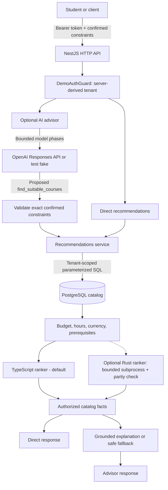

# AI Program Advisor

**An AI-powered course recommendation backend for online learning platforms.** It helps students select suitable programs from their academy's catalog based on budget, weekly study availability, and declared technical skills.

A student submits these constraints, and the service identifies eligible courses, ranks the matches, and returns their catalog-backed descriptions and prices. When explicitly enabled by the operator, an OpenAI-powered advisor can propose a validated catalog lookup and explain the recommendations. **Authentication, tenant access, suitability rules, and catalog facts remain under backend control.**

**Built with:** TypeScript · NestJS · Node.js · PostgreSQL · OpenAI Responses API · optional Rust · Terraform · Docker · LocalStack

## How it works

Consider a learner who has a **$300 budget**, **6 hours per week**, and declares **basic Python** knowledge:

1. **Confirm the learner's constraints.** The client submits structured budget, hours, and known skills. The authenticated credential identifies the academy; the learner cannot choose another tenant through request fields.
2. **Search that academy's active courses.** PostgreSQL supplies catalog prices, weekly workloads, and prerequisite requirements.
3. **Determine which courses fit.** Deterministic backend rules exclude offers outside the budget or available study hours, with an unsupported currency, or with undeclared prerequisites.
4. **Rank the suitable programs.** The default TypeScript path returns up to ten results in a consistent order. An empty recommendation list is a valid outcome.
5. **Explain the results when the advisor is enabled.** The model's lookup proposal is validated against the confirmed constraints. The response uses authorized catalog facts; an invalid final explanation can fall back to deterministic rendering after a successful lookup.

**Example:** With the included synthetic catalog fixture, the direct recommendation route returns `p3-a-102` followed by `p3-a-101` for the learner above. This is a local example, not a claim of live course inventory or verified admission eligibility. [Recommendation evidence](docs/verification/D1.3.md)

## What it does

- Exposes authenticated course-catalog and deterministic recommendation endpoints, plus an optional AI advisor endpoint.
- Derives tenant identity on the server and uses tenant-scoped PostgreSQL reads.
- Validates requests, eligibility constraints, model tool proposals, and customer-visible facts.
- Distinguishes a successful no-match outcome from a database failure, and provides bounded timeouts and sanitized errors.
- Keeps TypeScript ranking as the default, with an opt-in Rust integration whose output is checked against the TypeScript result.

## Architecture



The diagram describes application composition; it is **not** an AWS deployment diagram. The ordinary `src/main.ts` entrypoint enables the direct API, with the advisor disabled unless explicitly composed on the server. The optional Rust executable does not own tenant selection or suitability decisions. [Application composition](src/app.module.ts) · [Request trust boundaries](docs/architecture/b3b-tenant-trust-boundaries.md)

## Engineering highlights

| Engineering problem | Implemented decision | Evidence |
| --- | --- | --- |
| A caller tries to read another academy's courses | The credential determines a server-owned tenant context; catalog SQL binds `tenant_id` and filters active records | [Tenant isolation and PostgreSQL acceptance](docs/verification/D1.3.md) |
| A model proposes another tenant, altered constraints, or an invented price | Tool proposals must match confirmed constraints; final responses are constructed from catalog facts, not invented model values | [Advisor verification](docs/architecture/b3-gate-implementation-status.md) · [Day 5 closeout](docs/verification/D5-closeout.md) |
| A learner lacks prerequisites or exceeds budget | Backend filters by exact declared skills, USD budget, and weekly hours before ranking | [Suitability policy](src/recommendations/recommendations.policy.ts) · [Tests](tests/recommendations.unit.test.ts) |
| A catalog query fails | Return a sanitized unavailable response; distinguish failed reads from successful zero-match results | [Failure tests and incident defense](docs/verification/D5-closeout.md) |
| An external ranker adds failure and latency risk | Keep TypeScript as default; make Rust opt-in, deadline-bound, concurrency-limited, and subject to exact output parity checks | [Rust adapter](src/recommendations/rust-ranker.ts) · [Verification](docs/verification/D3-rust-ranking.md) |
| Infrastructure declarations need verification without cloud spend | Validate Terraform topology offline and exercise a VPC/subnet create-inspect-destroy lifecycle in LocalStack | [LocalStack lifecycle](docs/verification/D4-localstack.md) · [Architecture diagram](docs/architecture/d4-localstack.svg) |

## Verified results

| Verification | Result | Scope |
| --- | --- | --- |
| Day 5 TypeScript checks | Typecheck and compilation passed | Local verification |
| Day 5 final offline suites | **289 passed, 0 failed, 2 skipped** | 273 main-suite passes plus 16 supplemental passes; two release-Rust cases intentionally skipped |
| Day 3 Rust tests | **20 passed** | Retained standalone Rust unit/protocol results |
| Day 3 adapter benchmark, 7 candidates | TypeScript **0.005 ms** vs full Rust adapter **2.881 ms** median | 25 paired local samples; includes subprocess startup and parity checks |
| Day 3 adapter benchmark, 1,000 candidates | TypeScript **0.024 ms** vs full Rust adapter **4.645 ms** median | Same local methodology; TypeScript retained as default |
| Day 4 Terraform topology | **10 assertions passed** | Mocked offline Terraform test |
| Day 4 LocalStack lifecycle | **1 VPC and 1 subnet created, inspected, destroyed** | LocalStack Community 4.14.0; empty Terraform state and missing IDs after cleanup |

These figures are from distinct recorded checks, not a production load test or service-level objective. Day 5's first offline attempt encountered a test-fixture path error; the corrected rerun passed without application changes. [Full Day 5 evidence](docs/verification/D5-closeout.md) · [Rust benchmark details](docs/verification/D3-rust-ranking.md#benchmark)

## API

| Endpoint | Purpose | Behavior |
| --- | --- | --- |
| `GET /health` | Process-health check | Public; does not prove PostgreSQL readiness |
| `GET /catalog/offers` | List active offers for the authenticated academy | `200` with scoped rows; `401` without valid authentication; `503` on dependency failure |
| `POST /recommendations` | Deterministic course recommendations | `200` with ranked results or an empty list; invalid `400`; unauthorized `401`; unavailable `503` |
| `POST /advisor/recommendations` | Optional grounded AI advisor | Requires server-enabled advisor and confirmed constraints; provides controlled rejection, timeout and unavailable responses |

Direct recommendation request:

```json
{"budget_cents":30000,"weekly_hours":6,"known_skills":["basic-python"]}
```

Advisor request (when enabled in server composition):

```json
{
  "confirmed": true,
  "constraints": {
    "budget_cents": 30000,
    "weekly_hours": 6,
    "known_skills": ["basic-python"]
  }
}
```

Both protected routes require `Authorization: Bearer <demo credential>` and `Content-Type: application/json`. Inputs express a learner's declared constraints; they do not verify admission eligibility or authorize a purchase. [Route contracts](docs/verification/D1.3.md) · [Advisor composition](src/app.module.ts)

## Running and testing locally

Use Node.js 24.x and npm 11.x. The repository includes placeholder configuration in [.env.example](.env.example) and [config/d1.2.env.example](config/d1.2.env.example). Local PostgreSQL setup uses [compose.yaml](compose.yaml); inspect the documented fixture safeguards before starting it. Installation, database startup and integration execution require the operator's authorization and a verified local environment.

```sh
npm ci --ignore-scripts --no-audit --no-fund
npm run typecheck
npm run build
npm run test:unit
npm run test:recommendations:unit
```

The individual npm unit scripts are **not** the comprehensive 289-pass Day 5 command. For the complete documented offline suite, environment isolation and recorded outcomes, follow [D5-closeout.md](docs/verification/D5-closeout.md). For real local PostgreSQL setup and controlled integration runs, see [D1.2](docs/verification/D1.2.md) and [D1.3](docs/verification/D1.3.md). The optional Rust build and executable verification are recorded in [Day 3](docs/verification/D3-rust-ranking.md).

## Design decisions

- **Backend rules outrank model output.** The AI can propose a lookup or explanation, but cannot change tenant authority, offer facts, budget rules, prerequisites, or checkout permissions.
- **Deterministic recommendations first.** Default ranking sorts suitable offers by weekly study hours descending, price ascending, then offer identifier. The ordering is explicit and testable, not a learned prediction of student success.
- **TypeScript instead of Rust by default.** The measured full Rust adapter was slower at the tested sizes. Rust remains an optional, bounded integration rather than an unjustified default.
- **No-match is different from unavailable.** A successful empty query can return an empty result; a failed database lookup cannot masquerade as one.
- **Bounded work and safe failure.** Candidate reads use a 1,001-row sentinel to reject catalogs exceeding 1,000 active candidates. Model phases, output sizes, and optional Rust subprocesses have explicit limits; cancellation is cooperative and does not guarantee an already-running database query stops.

## Project scope and evidence

This repository is an **independent engineering portfolio implementation** using a synthetic academy catalog and controlled tests. Verified behavior covers local application logic, selected real local PostgreSQL and OpenAI acceptance paths, an optional Rust executable, and a two-resource LocalStack exercise. It does **not** claim a customer deployment, actual enrollment or sales outcomes, production identity, database Row-Level Security (RLS), live provider ingestion, checkout, or real AWS infrastructure operation.

- [Architecture overview](docs/architecture/overview.md) and [business invariants](AGENTS.md)
- [End-to-end reliability closeout](docs/verification/D5-closeout.md)
- [Advisor implementation and verification](docs/architecture/b3-gate-implementation-status.md)
- [Rust implementation and benchmark](docs/verification/D3-rust-ranking.md)
- [Terraform foundation and LocalStack cleanup](docs/verification/D4-localstack.md)
