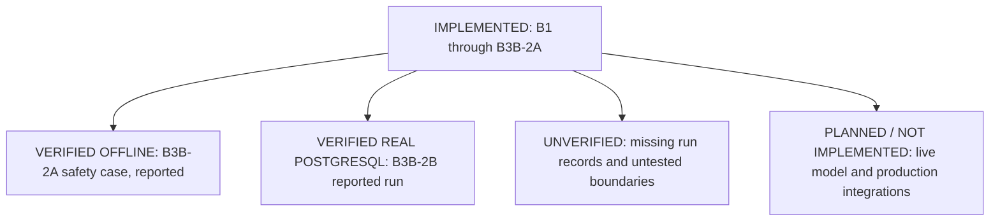

# B3 advisor implementation and verification status

P3 is a local portfolio simulation with fictional academy offers. This page describes the advisor implementation and the evidence available through B3B-2B. The [Day 0 system design](system-design.md) describes the production target.

| Milestone | Status | Source and evidence |
| --- | --- | --- |
| B1 | **IMPLEMENTED** | The tool contract validates confirmed constraints and the response policy preserves catalog facts and fixed reasons. [Tool contract](../../src/ai/tool.contract.ts) · [Grounding tests](../../tests/advisor.unit.test.ts) |
| B2 | **IMPLEMENTED** | Bounded orchestration supports up to two model phases and one business dispatch, plus deadlines, cancellation, and grounded fallback. [Advisor service](../../src/ai/advisor.service.ts) · [Orchestration tests](../../tests/advisor.orchestration.unit.test.ts) |
| B3A | **IMPLEMENTED** | Structured authenticated HTTP route with sanitized advisor errors and bounded, non-cacheable responses. [HTTP controller](../../src/ai/advisor.controller.ts) · [HTTP tests](../../tests/advisor.http.unit.test.ts) |
| B3B-1 | **IMPLEMENTED** | Server-selected `fake-model-postgres` composition wires the advisor to the existing recommendation service and repository. [App module](../../src/app.module.ts) · [Executor and fake-pool tests](../../tests/advisor.executor.unit.test.ts) |
| B3B-2A | **IMPLEMENTED**, **VERIFIED OFFLINE** | The SELECT-only acceptance scaffold includes a target-validation and fixture-comparison safety case. The offline case passed in the reported B3B-2B invocation. [Acceptance suite](../../tests/advisor.db.integration.test.ts) |
| B3B-2B | **VERIFIED REAL POSTGRESQL — reported execution evidence** | One reported invocation passed the offline case and the real PostgreSQL acceptance case. The repository contains the suite source. A matching durable B3B-2B execution log was unavailable at the P1 review. [Acceptance suite](../../tests/advisor.db.integration.test.ts) |

## Reported B3B-2B execution

The B3B-2B conversation report records two passed tests, zero failures, and zero skips. One case exercised real PostgreSQL at `127.0.0.1:55432` with database and role `p3_d12` and took 196.452 ms. It checked both academy scopes, active-offer filtering, deterministic order, and model-visible grounding in stored facts. The report records no live LLM, HTTP network listener, or fixture writes. The application and both pools closed.

The six fixture rows matched before and after the test. The reported SHA-256 for both canonical snapshots was `3b4029e931f5d93e5c74db0a11ae8640a1bab6efe4b84bd0bcd818a19432fca2`. The B3B-2B version formatter merged digits from the PostgreSQL banner, so the exact version for that run remains unverified. [Fixture and diagnostic assertions](../../tests/advisor.db.integration.test.ts)

D1.3 and D1.4 document earlier catalog and recommendation verification and independently record the same fixture digest. Their HTTP and PostgreSQL results apply to those earlier suites. The B3B-2B run is documented here as a reported result. [D1.3 verification](../verification/D1.3.md) · [D1.4 verification](../verification/D1.4.md)

## Remaining boundaries

- **UNVERIFIED** — Standalone B1 through B3B-1 execution records were unavailable at review. The test sources describe the intended coverage.
- **UNVERIFIED** — The advisor was exercised through in-process HTTP dispatch. The real PostgreSQL run used a six-row fixture, so the ten-result cap and 1,001st-candidate overflow sentinel have fake-pool assertions only for the B3 advisor path. [Acceptance suite](../../tests/advisor.db.integration.test.ts) · [Fake-pool cases](../../tests/advisor.executor.unit.test.ts)
- **PLANNED / NOT IMPLEMENTED** — A real model transport, a natural-language request interface, Rust ranking, provider catalog ingestion, checkout, production identity, and cloud deployment remain outside the implemented advisor.
- **UNVERIFIED** — Production security, including database-enforced tenant isolation, plus load, concurrency, and failover behavior. The local acceptance schema expects RLS to be disabled. [Acceptance schema audit](../../tests/advisor.db.integration.test.ts)
