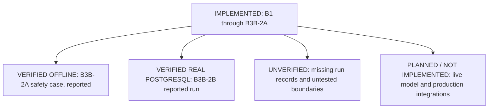

# B3 advisor implementation and verification status

P3 is a local portfolio simulation with fictional academy offers. This page records the Day 2 advisor implementation, observed acceptance outcomes and final offline verification. The [Day 0 system design](system-design.md) describes the production target.

| Milestone | Status | Source and evidence |
| --- | --- | --- |
| B1 | **IMPLEMENTED** | The tool contract validates confirmed constraints and the response policy preserves catalog facts and fixed reasons. [Tool contract](../../src/ai/tool.contract.ts) · [Grounding tests](../../tests/advisor.unit.test.ts) |
| B2 | **IMPLEMENTED** | Bounded orchestration supports up to two model phases and one business dispatch, plus deadlines, cancellation, and grounded fallback. [Advisor service](../../src/ai/advisor.service.ts) · [Orchestration tests](../../tests/advisor.orchestration.unit.test.ts) |
| B3A | **IMPLEMENTED** | Structured authenticated HTTP route with sanitized advisor errors and bounded, non-cacheable responses. [HTTP controller](../../src/ai/advisor.controller.ts) · [HTTP tests](../../tests/advisor.http.unit.test.ts) |
| B3B-1 | **IMPLEMENTED** | Server-selected `fake-model-postgres` composition wires the advisor to the existing recommendation service and repository. [App module](../../src/app.module.ts) · [Executor and fake-pool tests](../../tests/advisor.executor.unit.test.ts) |
| B3B-2A | **IMPLEMENTED**, **VERIFIED OFFLINE** | The SELECT-only acceptance scaffold includes a target-validation and fixture-comparison safety case. The offline case passed in the reported B3B-2B invocation. [Acceptance suite](../../tests/advisor.db.integration.test.ts) |
| B3B-2B | **VERIFIED REAL POSTGRESQL** | One invocation passed the offline case and the real PostgreSQL case with a fake model. The execution log was unavailable at the P1 review and recovered during the Day 2 acceptance audit. [Acceptance suite](../../tests/advisor.db.integration.test.ts) |
| B3C-1 and B3C-2A | **IMPLEMENTED**, **VERIFIED OFFLINE** | The Responses API adapter and offline-by-default runner were tested with mocked transport and database pools. [Adapter](../../src/ai/openai.model.client.ts) · [Adapter tests](../../tests/advisor.openai.unit.test.ts) · [Runner](../../scripts/b3c2-live-acceptance.mjs) |
| B3C-2B | **FAILED LIVE ACCEPTANCE**, **VERIFIED FAILURE CONTAINMENT** | The default-profile initial model request timed out before business dispatch. |
| B3C-2C | **ANALYSIS RECORDED** | The client-side phase deadline covered transport and adapter work. The failure record did not isolate provider processing time. |
| B3C-2D and B3C-2F | **IMPLEMENTED**, **VERIFIED OFFLINE** | Mocked regressions exercised sanitized timing diagnostics and the test-only deadline override. [Composition](../../src/app.module.ts) · [Runner tests](../../tests/b3c2-runner.offline.test.mjs) |
| B3C-2E | **INSUFFICIENT EVIDENCE** for the standalone design rationale | The owner-approved profile was recovered from the B3C-2F authorization and is documented below. |
| B3C-2G | **VERIFIED LIVE OPENAI AND POSTGRESQL** | One synthetic request completed under the explicit experimental profile. |

The diagram preserves the evidence available at the earlier B3B checkpoint.

## B3B-2B PostgreSQL acceptance

The B3B-2B report and recovered test output record two passed tests, zero failures and zero skips. The real PostgreSQL case used the synthetic `p3_d12` database and role at `127.0.0.1:55432` and took 196.452 ms. It used in-process HTTP and a fake model to verify both academy scopes, rejection of unauthorized tenant overrides, active-offer filtering, deterministic order, a valid no-match result and grounding in stored facts. The application and both pools closed. The run opened no HTTP listener and made no fixture writes or live model calls.

The six fixture rows matched before and after the test. The reported SHA-256 for both canonical snapshots was `3b4029e931f5d93e5c74db0a11ae8640a1bab6efe4b84bd0bcd818a19432fca2`. The B3B-2B version formatter merged digits from the PostgreSQL banner, so the exact version for that run remains unverified. [Fixture and diagnostic assertions](../../tests/advisor.db.integration.test.ts)

D1.3 and D1.4 document earlier catalog and recommendation verification and independently record the same fixture digest. Their HTTP and PostgreSQL results apply to those earlier suites. [D1.3 verification](../verification/D1.3.md) · [D1.4 verification](../verification/D1.4.md)

## B3C-2B default-profile live timeout

The runner was invoked once and exited 1. It made one initial OpenAI POST attempt. The 2,000 ms initial deadline expired, with an observed initial phase of 2,008.754 ms and an advisor duration of 2,016.109 ms. The advisor returned HTTP 504. Zero proposals were validated and zero business SQL dispatches occurred. This was a failed integration attempt with verified failure containment.

Both database sessions passed read-only checks, the six-row fixture was unchanged and the application and both pools closed. Provider processing, token usage and billing are **UNKNOWN**.

## B3C-2G experimental live acceptance

One separately authorized runner invocation exited 0. It made two real OpenAI Responses API POST attempts with zero retries. Both phases requested `gpt-4.1-mini` and returned `gpt-4.1-mini-2025-04-14`, HTTP 200 and status `completed`.

The advisor validated one `find_suitable_courses` proposal and issued exactly one business SELECT for authenticated Academy A with parameters `["academy-a", 1001]`. It returned HTTP 200, status `completed` and `Cache-Control: no-store`. The grounding source was `accepted_plan`, with offers `p3-a-102` and `p3-a-101` in that order.

| Client-observed phase | Duration |
| --- | ---: |
| Initial model | 2,090.726 ms |
| Business SELECT | 2.050 ms |
| Final model | 1,458.752 ms |
| Total advisor | 3,559.029 ms |

OpenAI reported 290 input tokens and 66 output tokens combined. The estimated cost was $0.0002216 USD. Actual billing was not independently verified.

Both PostgreSQL sessions passed read-only checks. Before and after both live attempts, the six-row fixture matched SHA-256 `3b4029e931f5d93e5c74db0a11ae8640a1bab6efe4b84bd0bcd818a19432fca2`. The application and both pools closed successfully. B3C-2G made no source changes or Git publication changes.

### Deadline profiles

| Phase | Default | Explicit experiment |
| --- | ---: | ---: |
| Initial | 2,000 ms | 15,000 ms |
| Business | 2,500 ms | 2,500 ms |
| Final | 1,000 ms | 8,000 ms |
| Overall | 6,000 ms | 30,000 ms |
| Runner watchdog | 7,000 ms | 35,000 ms |

Trusted server-side OpenAI composition selects the experimental profile explicitly. The default advisor budgets still apply without that selection, and ordinary startup keeps the advisor disabled. The runner watchdog bounds in-process HTTP dispatch. [Advisor deadlines](../../src/ai/advisor.service.ts) · [Composition](../../src/app.module.ts) · [Runner](../../scripts/b3c2-live-acceptance.mjs)

## Gate 2 final offline verification

The fresh run passed **238 offline tests, zero failed and zero skipped**. It covered advisor tool contracts, orchestration, HTTP handling, the business executor, the OpenAI adapter, the acceptance runner, and catalog and deterministic recommendation regressions. Strict TypeScript type checking, fresh compilation and syntax checks passed. No real OpenAI or PostgreSQL execution occurred during Gate 2.

An independent compilation reproduced all 32 emitted files byte for byte, including 21 application modules. The application-only SHA-256 was `a2a67e7f3fcb4038da15851ed0a72a8b8562338db6853aef2432c57d35422374`, matching the B3C-2G build. The digest hashes the compact JSON array of sorted `[relative path, file SHA-256]` pairs. Paths are relative to the emitted `src/` directory.

## Remaining boundaries

- **INSUFFICIENT EVIDENCE** — The original full Day 2 acceptance checklist and the standalone B3C-2E design rationale were unavailable. Standalone B1 through B3B-1 run records were unavailable at the earlier review. Gate 2 supplies fresh offline results for those suites.
- **UNVERIFIED** — The advisor was exercised through in-process HTTP dispatch. The real PostgreSQL run used a six-row fixture, so the ten-result cap and 1,001st-candidate overflow sentinel have fake-pool assertions only for the B3 advisor path. [Acceptance suite](../../tests/advisor.db.integration.test.ts) · [Fake-pool cases](../../tests/advisor.executor.unit.test.ts)
- **PLANNED** — Natural-language intake, Rust ranking, real provider catalog ingestion, verified admission, checkout, production identity and cloud deployment are outside the implemented advisor.
- **UNVERIFIED** — Production readiness, load, concurrency, failover and database-enforced tenant isolation. The fixture has Row-Level Security (RLS) disabled. Demo bearer credentials and tenant-parameterized SQL provide the exercised application boundary. [Acceptance schema audit](../../tests/advisor.db.integration.test.ts)
- **UNVERIFIED** — The single successful live sample supplies no latency distribution or operational service-level objective (SLO). Client-side cancellation is cooperative. Provider work and billing after abort remain unknown.
