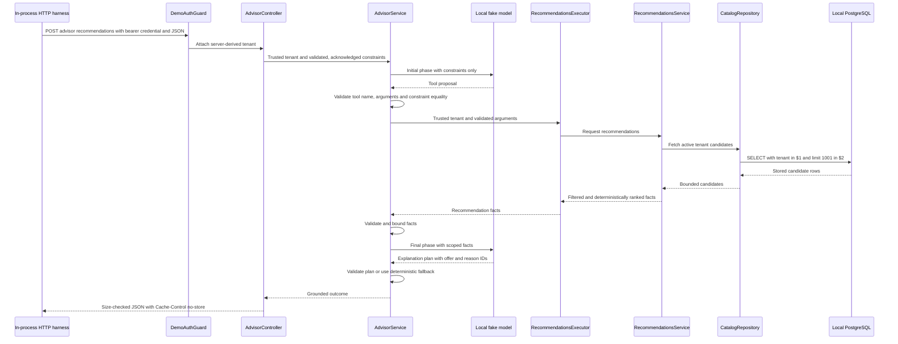

# Advisor HTTP-to-PostgreSQL sequence

The B3B-2B harness selected `fake-model-postgres` through a server-owned application override and injected its PostgreSQL application pool. It dispatched HTTP requests in process through NestJS without opening an HTTP listener. The initial and final model phases ran a local fake, while catalog queries reached real local PostgreSQL. The normal application entrypoint omits the override and leaves the advisor disabled. [Application composition](../../src/app.module.ts) · [Normal entrypoint](../../src/main.ts) · [Acceptance harness](../../tests/advisor.db.integration.test.ts)

## Request and catalog policy

The guarded `POST /advisor/recommendations` accepts a JSON envelope containing only `constraints` and `confirmed: true`. The caller acknowledges structured budget, weekly hours, and known skills. The guard supplies the tenant independently. The only permitted tool is `find_suitable_courses`. Its raw JSON arguments are capped at 4,096 bytes and must match the acknowledged budget and hours exactly, with the same set of known skills. [HTTP controller](../../src/ai/advisor.controller.ts) · [Tool contract](../../src/ai/tool.contract.ts)

The successful path makes one business dispatch. `RecommendationsExecutor` forwards the trusted scope and validated arguments to `RecommendationsService`. The repository binds the tenant in `tenant_id = $1`, selects active offers, and binds `1001` as the query limit. A 1,001st row causes refusal. The TypeScript policy filters for USD, budget, weekly hours, and exact declared prerequisites. It ranks by study hours descending, price ascending, then offer ID ascending, and returns at most ten offers. [Executor](../../src/ai/advisor.executor.ts) · [Recommendations service](../../src/recommendations/recommendations.service.ts) · [Catalog query](../../src/catalog/catalog.repository.ts) · [Ranking policy](../../src/recommendations/recommendations.policy.ts)

## Grounding and failure paths

The advisor checks fact shape, suitability, count, and size before sending a detached snapshot to the final fake-model phase. A valid plan references every offer in the existing order with the fixed reason IDs. The response uses stored offer fields and server-owned reasons. A missing, invalid, failed, or timed-out final explanation can use deterministic fallback after successful fact validation. An empty successful read can yield a completed empty result. Invalid proposals stop before catalog access, and business failures return a sanitized error. [Orchestration](../../src/ai/advisor.service.ts) · [Response policy](../../src/ai/response.policy.ts)

The phase budgets are 2,000 ms for the initial model phase, 2,500 ms for business work, and 1,000 ms for the final model phase within a 6,000 ms overall deadline. The controller caps serialized advisor responses at 40,960 UTF-8 bytes. These limits describe application behavior. B3B-2B exercised in-process HTTP and real reads over a six-row local fixture. Network HTTP behavior and both large-catalog boundaries remain unverified on the real-SQL advisor path. [Orchestration limits](../../src/ai/advisor.service.ts) · [HTTP response handling](../../src/ai/advisor.controller.ts) · [Verification status](b3-gate-implementation-status.md)
