# Advisor tenant trust boundaries

Tenant scope starts at the server’s credential check. `DemoAuthGuard` maps one of two configured demo bearer credentials to Academy A or Academy B and attaches an immutable tenant context to the request. Query and header tenant claims are ignored for authority. Unexpected body keys, including tenant overrides at either envelope level, are rejected. [Demo guard](../../src/catalog/demo-auth.guard.ts) · [Tenant context](../../src/catalog/tenant-context.ts) · [HTTP controller](../../src/ai/advisor.controller.ts)

```mermaid
flowchart LR
    Config["Private process configuration"]
    Caller["Untrusted caller"]
    Claims["Caller tenant claims"]
    Model["Local fake model"]
    subgraph App["Server-owned application boundary"]
        Guard["DemoAuthGuard"]
        Controller["AdvisorController"]
        Advisor["AdvisorService and tool contract"]
        Executor["RecommendationsExecutor"]
        Policy["RecommendationsService"]
        Repo["CatalogRepository"]
        Pool["Acceptance application pool"]
    end
    DB[("Local PostgreSQL synthetic catalog")]

    Config -->|Demo credentials| Guard
    Config -->|Connection settings| Pool
    Caller -->|Bearer credential| Guard
    Caller -->|Structured constraints and acknowledgement| Controller
    Guard -->|Server-derived tenant| Controller
    Claims -.->|Query and header ignored, body rejected| Controller
    Controller -->|Trusted tenant and validated constraints| Advisor
    Advisor -->|Initial constraints and final scoped facts| Model
    Model -->|Untrusted tool proposal and explanation plan| Advisor
    Advisor -->|Trusted tenant and validated arguments| Executor
    Executor --> Policy
    Policy --> Repo
    Repo -->|Tenant-bound active SELECT| Pool
    Pool -->|Read-only acceptance connection| DB
    DB -->|Stored catalog facts| Pool
    Advisor -->|Grounded outcome or sanitized failure| Controller
```

## Authority over data and decisions

The model interface receives only structured constraints in the initial phase and bounded scoped facts in the final phase. Credentials, tenant identity, and confirmation authority stay within the application. A model-provided tenant field fails tool validation. The trusted tenant travels through the executor and service to the repository, where `tenant_id = $1` and `active = TRUE` scope the SELECT before any catalog facts reach the model. The response policy validates reference order and reason IDs and copies the facts from the authorized result. PostgreSQL owns the synthetic titles, prices, prerequisites, and study hours. Self-declared skills establish suitability under the local policy. Admission and checkout are outside this flow. [Model interface](../../src/ai/model.client.ts) · [Tool validation](../../src/ai/tool.contract.ts) · [Catalog repository](../../src/catalog/catalog.repository.ts) · [Response policy](../../src/ai/response.policy.ts)

## Configuration, safeguards, and containment

- The application reads `DATABASE_URL`, `P3_DEMO_TOKEN_A`, and `P3_DEMO_TOKEN_B` from process configuration. The B3B-2B launcher reportedly injected the database connection settings and two ephemeral demo tokens into the acceptance child process. [Configuration loader](../../src/config.ts) · [Verification status](b3-gate-implementation-status.md)
- The opt-in acceptance suite restricts the target to the approved loopback endpoint and database and role `p3_d12`. Both pools request read-only startup defaults and verify identity, transaction read-only settings, and search path on each connection. The separate audit pool checks schema and compares the complete fixture before and after the application checks. The schema audit expects the fixture relation to have RLS disabled. The test safeguards provide local evidence for the tested paths. Production identity, least-privilege database roles, and database-enforced tenant isolation remain unestablished. [Acceptance harness](../../tests/advisor.db.integration.test.ts)
- The advisor namespace uses sanitized error codes and `Cache-Control: no-store`. Authentication failures and rejected authority overrides stop before business SQL in the tested paths. Catalog failure or overflow yields an unavailable result. Request abort and premature response closure signal cooperative cancellation. The executor checks cancellation before and after the service call, and work already running in PostgreSQL may continue until it completes or reaches the statement timeout. [HTTP controller](../../src/ai/advisor.controller.ts) · [Executor](../../src/ai/advisor.executor.ts) · [Acceptance pool settings](../../tests/advisor.db.integration.test.ts)
