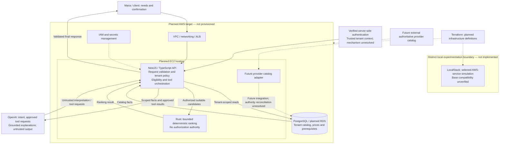

# System design

**TARGET ARCHITECTURE — NOT IMPLEMENTED END TO END**

Evidence classifications and provenance are defined in the [overview](overview.md). Component directions below are **CONFIRMED — OWNER DAY 0 RECAP**, with the core target stack corroborated by [AGENTS.md](../../AGENTS.md) and [README.md](../../README.md). Connections show intended responsibilities, not running integrations or an accepted runtime sequence.

## Component and trust boundaries

Solid arrows indicate intended logical interactions. Dashed arrows indicate future integration/provisioning relationships. Neither proves implementation. The provider-to-database path is a conceptual adapter boundary; synchronization and write policy remain unresolved.

| Component | Planned responsibility and limit |
| --- | --- |
| Client | Submit learner needs; provide explicit confirmation for a separately controlled future handoff. Cannot grant tenant authority. |
| NestJS/TypeScript | HTTP API, validation, authentication, trusted tenant context, business policy, model/tool orchestration, response validation and safe failures. |
| PostgreSQL | Authoritative fictional offers, current synthetic prices, tenant ownership, metadata and prerequisites. Real database reads are planned for D1.2. |
| Rust | Rank a bounded authorized, suitable candidate set deterministically. Cannot grant access, waive prerequisites or authorize checkout. |
| OpenAI | Interpret student intent, request approved bounded tools and explain validated catalog facts. Cannot override tenant, price or eligibility authority. |
| Provider adapter | Preserve a future real-provider integration boundary without asserting a provider contract or implemented ingestion. |

## Ordering and checkout

**UNRESOLVED:** Exact ranking/model call order. The diagram is not a sequence diagram. Model assistance may help interpret needs, but all tool access and final responses remain backend-controlled. Missing trusted identity must not become default tenant access; unknown eligibility cannot silently pass.

**CONFIRMED — OWNER DAY 0 RECAP:** A future mock checkout handoff requires fresh server-side revalidation of price, eligibility and availability, followed by explicit user confirmation. Recommendations grant no checkout authority.

**PROPOSED:** Bind confirmation to the revalidated terms and require renewed validation/confirmation if they expire or materially change. Atomicity, expiry and provider guarantees remain unresolved; this documentation does not promise reservation or purchase consistency.

## Infrastructure and actual implementation

EC2, RDS, VPC/networking, ALB, IAM, secrets management and Terraform are production-style design targets. Instance sizes, subnet/CIDR definitions, availability configuration and failover are **UNRESOLVED**. There are no deployed resources.

LocalStack is a separate bounded AWS-service simulation target, not an application database substitute or proof of AWS parity. Long-term use must fit Base rather than depend on Ultimate-only trial capabilities. Service compatibility, entitlement and API behavior are unverified. Local application verification would also be distinct from service emulation.

**CONFIRMED — REPOSITORY:** Only the D1.1 harness exists, as described in [verification evidence](../verification/D1.1.md); D1.1A adds documents. REST contracts, SQL schema/migrations/connection strategy, Rust interop/scoring and model/tool budgets remain **UNRESOLVED**. No queues, exact endpoints or FFI mechanism are selected here. See [decisions](decisions.md), [security](security.md) and [roadmap](roadmap.md).
