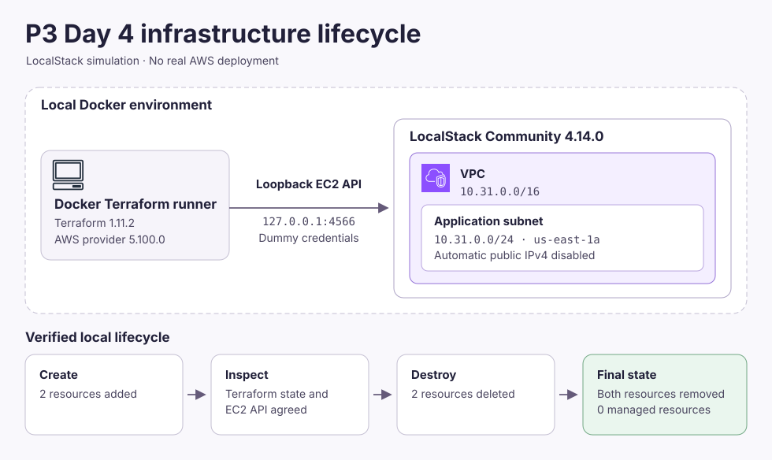

# Day 4 LocalStack verification

On November 22, 2026 (Panama), Terraform planned two P3 resources against the LocalStack configuration. The owner authorized apply and inspection, then separately authorized destruction of those exact resources. The full create, inspect and delete lifecycle was verified in LocalStack Community 4.14.0.



The editable source is a layered Inkscape SVG. The plain SVG export is self-contained. The diagram uses the AWS Client and Virtual private cloud group icons from the July 31, 2026 package. [Editable source](../architecture/d4-localstack.source.svg) · [AWS Architecture Icons](https://aws.amazon.com/architecture/icons/)

## Engineering review

| Verified engineering evidence | Business reasoning |
| --- | --- |
| Terraform 1.11.2 and AWS provider 5.100.0 passed offline initialization, validation and one mocked topology run with ten assertions. [Foundation record](D4-R2-infrastructure.md#retained-offline-follow-up) | I can review network, IAM and database declarations for a future operator-led walkthrough before authorizing cloud spend or access. |
| The runner used a loopback-only EC2 endpoint and dummy credentials. The saved plan created exactly one VPC and its application subnet. | I can demonstrate the infrastructure workflow locally without using cloud credentials or touching the existing catalog service. |
| Terraform state and an independent EC2 read agreed on the VPC ID, subnet membership, zone and disabled automatic public IPv4. | I check what the emulator reports as well as what Terraform records, so a successful command alone cannot stand in for the expected result. |
| The separately approved destroy created no resources and removed both IDs. Final state and tag queries were empty. | I can close the exercise with evidence that the two test resources were removed and the original catalog container stayed healthy. |

## Repository and Docker baseline

- The Git root matched the supplied workspace. Branch `main` was at `f0dec80a0513c386e57c7ef199e1b0119aee9f43`, tracking the local `origin/main` ref. The configured origin was `https://github.com/CEAG0712/AI-Program-Advisor`. The untracked baseline was seven files in `infra/aws` and the D4-R2 evidence. All seven Terraform and test files matched the retained SHA-256 manifest before and after the plan. [Operating contract](../../AGENTS.md) · [D4-R2 source review](D4-R2-infrastructure.md)
- The existing Compose file only defines `p3-d12-postgres`, with its own volume and port bound to `127.0.0.1:55432`. The container was healthy before and after the plan. The authenticated offline runner's inspection matched its retained record byte for byte. It was running on Docker network `none`, with no mounts or published ports. The Terraform executable was copied out with `docker cp`. [Compose configuration](../../compose.yaml)
- No LocalStack container, cached image or CLI was present at inspection. The initial sandboxed Docker query exited 1 with socket permission denied. The approved inventory succeeded. This run pulled the official legacy Community 4.14.0 Linux ARM64 image and pinned the registry digest. Current unified LocalStack releases require an auth token. [LocalStack 4.14.0 release](https://github.com/localstack/localstack/releases/tag/v4.14.0) · [Unified image release](https://blog.localstack.cloud/localstack-for-aws-release-2026-03-0/)
- The retained directory `/private/tmp/p3-d4-final.pPJnH5rW/resume.INtfoKQO` records successful provider verification, init, validation and one passing mocked topology test with ten assertions. The later run verified the original files against that baseline and used the test result as retained evidence.

## Scope and plan results

| P3 area | Result |
| --- | --- |
| VPC and application subnet | Live loopback queries returned `us-east-1a` as available. Create, describe and delete passed for the two authorized resources. Both fixture tags returned empty results before apply and after destroy. |
| EC2 instance, security groups and routing | EC2 is enabled in mock mode. Instance launch and the production routing and security-group resources were outside this plan. Runtime, IMDSv2, Session Manager and packet behavior remain unverified. |
| IAM | The installed image lists IAM in its service inventory. It was disabled for this run. Role, policies, instance profile and policy enforcement remain unverified. |
| RDS | The installed Community service inventory has no RDS entry. LocalStack's current plan table also excludes RDS from Hobby. The subnet group, PostgreSQL instance, managed password, and dependent IAM denial remain outside this integration. |

[EC2 API coverage and mock mode](https://docs.localstack.cloud/aws/services/ec2/) · [LocalStack service plans](https://docs.localstack.cloud/aws/licensing/) · [LocalStack IAM coverage](https://docs.localstack.cloud/aws/services/iam/)

| Reviewed create action | Selected planned values |
| --- | --- |
| `aws_vpc.advisor` | `10.31.0.0/16`, DNS support and DNS hostnames both enabled, tag `p3-d4-local-vpc` |
| `aws_subnet.application` | `10.31.0.0/24`, `us-east-1a`, automatic public IPv4 disabled, tag `p3-d4-local-application`, VPC ID references `aws_vpc.advisor.id` |

`Plan: 2 to add, 0 to change, 0 to destroy.` JSON inspection confirmed the two managed creates, their attributes and dependency, and a complete, applyable plan. Planning wrote no state. The only Terraform source diff is the emulator provider configuration. The disposable root uses the original two resource blocks and required inputs from P3. [Local provider configuration](../../infra/localstack/versions.tf) · [P3 network](../../infra/aws/network.tf)

| Command | Exit | Elapsed seconds |
| --- | ---: | ---: |
| `version` | 0 | 1 |
| `fmt -check -diff` | 0 | <1 |
| `init -backend=false -input=false -lockfile=readonly` | 0 | 7 |
| `validate` | 0 | 4 |
| `plan -detailed-exitcode` | 2 (planned changes) | 5 |
| `show` and `show -json` | 0 each | 2 and 1 |

Two runner preflight attempts exited 1 and 2 before Terraform. Docker Desktop listed inactive tunnel interfaces, and one sysfs entry lacked an interface flag file. The final check allows inactive interfaces and requires an empty IPv4 route table. The initial format check exited 3 over alignment. The initial init exited 1 because a lockfile constraint included an explicit equals sign. The retry used Terraform's normalized lockfile syntax. Init labels this mirror installation unauthenticated. The provider ZIP was independently authenticated in the retained run, and this run rechecked its SHA-256 against the signed manifest and the recorded registry digest. The copied Terraform executable matched the executable from the previously authenticated archive.

Docker reports the prepared container as unhealthy because the initial `--health-cmd=none` set a literal shell command that exits 127. The actual loopback health API reported Community 4.14.0 with EC2 running and the live EC2 queries passed. Use `--no-healthcheck` when reproducing. The emulator logged a blocked attempt to resolve its optional certificate endpoint and used its self-signed fallback. Neither container had an external route. There were no real AWS API calls, credentials or resource changes.

The saved plan, readable plan and JSON, command results, health evidence, and isolation inspection are in `/private/tmp/p3-d4-localstack.114hhykO`. The saved plan SHA-256 is `7e7000698bbda5a16b46cf6af675f61c1a787b4997709b656c28104a52219f36`.

## Authorized apply and inspection results

**VERIFIED in LocalStack Community 4.14.0.** Before apply, the saved plan matched the reviewed SHA-256 and both retained renderings byte for byte. Its only managed actions were the two creates. The provider configuration embedded in the plan specified only `http://127.0.0.1:4566` for EC2 and disabled metadata, credential, region and account discovery. The existing runner used a blank environment with dummy credentials and shared the emulator's loopback-only network. The emulator's container identity and configuration matched the retained inspection. Its loopback health API reported EC2 running, no active interface existed beyond loopback, and the two tag queries returned empty arrays. The known Docker health-check label did not require a restart.

| Terraform address | Matching Terraform state and LocalStack API result |
| --- | --- |
| `aws_vpc.advisor` | `vpc-1a6424dbfaef8e627`, `10.31.0.0/16`, available. DNS support and DNS hostnames both enabled. |
| `aws_subnet.application` | `subnet-3b331fef9739b1a65`, `10.31.0.0/24`, belongs to `vpc-1a6424dbfaef8e627`, zone `us-east-1a`, automatic public IPv4 disabled. |

The commands below used the runbook's `tf` and `ec2` wrappers and the existing container ID. Exit codes and elapsed seconds are recorded per command in `/private/tmp/p3-d4-localstack.114hhykO/apply-inspect/results.log`; the same directory holds the captured outputs.

| Command | Exit and result |
| --- | --- |
| `shasum -a 256 -c create.tfplan.sha256`, `tf show -no-color /work/create.tfplan`, `tf show -json /work/create.tfplan` | 0 each. Checksum and exact plan review passed. |
| `tf apply -input=false -no-color /work/create.tfplan` | 0 in 14 seconds. Terraform reported `2 added, 0 changed, 0 destroyed`. |
| `tf state list`, `tf show -json` | 0 each. State contained exactly the two addresses above. |
| `ec2 describe-vpcs --filters Name=tag:Name,Values=p3-d4-local-vpc --query 'Vpcs[].{Vpc:VpcId,Cidr:CidrBlock,State:State}' --output json` | 0. Exactly one VPC matched. |
| `ec2 describe-subnets --filters Name=tag:Name,Values=p3-d4-local-application --query 'Subnets[].{Subnet:SubnetId,Vpc:VpcId,Cidr:CidrBlock,AZ:AvailabilityZone,PublicIPv4:MapPublicIpOnLaunch}' --output json` | 0. Exactly one subnet matched. |
| `ec2 describe-vpcs --filters Name=tag:Name,Values=p3-d4-local-vpc --query 'Vpcs[0].VpcId' --output text` | 0. Returned `vpc-1a6424dbfaef8e627`. |
| `ec2 describe-vpc-attribute --vpc-id vpc-1a6424dbfaef8e627 --attribute enableDnsSupport --output json` and the same command with `--attribute enableDnsHostnames` | 0 each. Both returned true. |

Both resources were present at the end of the apply phase. The local state is in `/private/tmp/p3-d4-localstack.114hhykO/root/terraform.tfstate`.

## Authorized resource cleanup results

**VERIFIED in LocalStack Community 4.14.0.** The existing state and independent EC2 lookups identified exactly the two resources authorized for deletion. The original emulator responded at `http://127.0.0.1:4566`. Docker was using a local Unix socket, the emulator was on network `none`, only loopback was active, and the runner supplied dummy credentials from a clean environment. The destroy plan embedded the same loopback EC2 endpoint and credential discovery settings as the create plan.

| Destroy plan JSON address | Prior ID and action |
| --- | --- |
| `aws_subnet.application` | `subnet-3b331fef9739b1a65`, `["delete"]` |
| `aws_vpc.advisor` | `vpc-1a6424dbfaef8e627`, `["delete"]` |

The plan had two deletes, zero creates, updates or replacements, and no reported drift. Saved plan SHA-256 `dfdc1a55e53df920b69556a36bda69fdc7804bddd0d988c13e2270bfa044d961`. The plan, state, runner and provider configuration checksums matched just before execution.

| Command | Exit and observed result |
| --- | --- |
| `tf state list` and `tf show -json` before destroy | 0 each. Both expected addresses and IDs matched. |
| `ec2 describe-vpcs --vpc-ids vpc-1a6424dbfaef8e627 --query 'Vpcs[].VpcId' --output json` and `ec2 describe-subnets --subnet-ids subnet-3b331fef9739b1a65 --query 'Subnets[].SubnetId' --output json` before destroy | 0 each. Each lookup returned its requested ID. |
| `tf plan -destroy -input=false -no-color -out=/work/destroy.tfplan` | 0 in 8 seconds. `0 to add, 0 to change, 2 to destroy`. |
| `tf show -no-color /work/destroy.tfplan` and `tf show -json /work/destroy.tfplan` | 0 each. JSON review verified the exact delete set and loopback endpoint. |
| `tf apply -input=false -no-color /work/destroy.tfplan` | 0 in 4 seconds. `0 added, 0 changed, 2 destroyed`. The subnet was destroyed first. |
| `tf state list` and `tf show -json` after destroy | 0 each. The state list was empty and the state file contained zero managed resources. |
| Repeat both exact-ID EC2 commands after destroy | 255 each, with the expected `InvalidVpcID.NotFound` and `InvalidSubnetID.NotFound` errors for the requested IDs. |
| `ec2 describe-subnets --filters Name=tag:Name,Values=p3-d4-local-application --query Subnets --output json` and `ec2 describe-vpcs --filters Name=tag:Name,Values=p3-d4-local-vpc --query Vpcs --output json` | 0 each. Both returned `[]`. |
| `docker --context desktop-linux ps -aq --no-trunc`, then `docker --context desktop-linux inspect --format` for those IDs, then compare sorted snapshots with `cmp` | The initial snapshot exited 1 because some containers had no health field. The corrected snapshot and comparison exited 0. All 27 records matched across container IDs, images, status, timestamps, restart counts, networks, mounts and health where present. PostgreSQL remained running and healthy with its original data volume. The LocalStack health API also returned the same response before and after. |

The existing wrappers and the exact executed arguments, outputs, per-command exit codes and measured durations are recorded under `/private/tmp/p3-d4-localstack.114hhykO/destroy-inspect/`. The LocalStack container and its volume remain in place. No real AWS calls or credentials were used. The local test covers emulator behavior for these two resource types. Real AWS network behavior, IAM, RDS, encryption, availability, recovery and deployment remain unverified.

## Apply, inspect and destroy after owner approval

Use the retained isolated runner and the same LocalStack instance. The runner creates a temporary Debian container for each Terraform invocation, shares only the emulator's loopback namespace, and mounts the disposable working directory. Check that the container ID is still `327424f3b2adbbf4e6c884acdf962d80573827bb3a43558b40d3a5b70c24e1f9`, and that the emulator still reports EC2 running before using the plan.

```sh
work=/private/tmp/p3-d4-localstack.114hhykO
tf() { "$work/tf-local" "$@"; }
ec2() {
  docker --context desktop-linux exec p3-d4-localstack-plan /usr/bin/env -i \
    PATH=/usr/local/bin:/usr/bin:/bin HOME=/tmp AWS_ACCESS_KEY_ID=test \
    AWS_SECRET_ACCESS_KEY=test AWS_DEFAULT_REGION=us-east-1 AWS_EC2_METADATA_DISABLED=true \
    AWS_CONFIG_FILE=/dev/null AWS_SHARED_CREDENTIALS_FILE=/dev/null AWS_PAGER= \
    aws --endpoint-url http://127.0.0.1:4566 ec2 "$@"
}

docker --context desktop-linux inspect --format '{{.Id}} {{.HostConfig.NetworkMode}}' p3-d4-localstack-plan
docker --context desktop-linux exec p3-d4-localstack-plan \
  curl --noproxy '*' -fsS --max-time 5 http://127.0.0.1:4566/_localstack/health
(cd "$work" && shasum -a 256 -c create.tfplan.sha256)
tf show -no-color /work/create.tfplan
```

With separate apply approval, apply the reviewed plan. Check that the tags each resolve to one resource, the subnet's VPC ID matches the VPC, and both VPC attributes are true.

```sh
tf apply -input=false -no-color /work/create.tfplan
tf state list
ec2 describe-vpcs --filters Name=tag:Name,Values=p3-d4-local-vpc \
  --query 'Vpcs[].{Vpc:VpcId,Cidr:CidrBlock,State:State}'
ec2 describe-subnets --filters Name=tag:Name,Values=p3-d4-local-application \
  --query 'Subnets[].{Subnet:SubnetId,Vpc:VpcId,Cidr:CidrBlock,AZ:AvailabilityZone,PublicIPv4:MapPublicIpOnLaunch}'
vpc_id=$(ec2 describe-vpcs --filters Name=tag:Name,Values=p3-d4-local-vpc \
  --query 'Vpcs[0].VpcId' --output text)
ec2 describe-vpc-attribute --vpc-id "$vpc_id" --attribute enableDnsSupport
ec2 describe-vpc-attribute --vpc-id "$vpc_id" --attribute enableDnsHostnames
```

With destroy approval, save and inspect a destroy plan before applying it. Expect only the two deletes above. If an apply was partial, reconcile Terraform state with both tag queries before approving this step.

```sh
tf plan -destroy -input=false -no-color -out=/work/destroy.tfplan
tf show -no-color /work/destroy.tfplan
tf apply -input=false -no-color /work/destroy.tfplan
tf state list
ec2 describe-subnets --filters Name=tag:Name,Values=p3-d4-local-application --query Subnets
ec2 describe-vpcs --filters Name=tag:Name,Values=p3-d4-local-vpc --query Vpcs
```

Expect an empty state list and two empty API results. Retain evidence before cleanup. With cleanup authorization, run `docker --context desktop-linux stop p3-d4-localstack-plan` and `docker --context desktop-linux rm -v p3-d4-localstack-plan` to remove the emulator and its anonymous volume. The runner containers remove themselves. The isolated working directory can be deleted after evidence is retained. Keep the existing offline runner and catalog containers out of cleanup.

## Reproduce the plan

Use the retained authenticated Terraform executable and provider archive. Start a new emulator only when the prepared instance is no longer available.

```sh
docker --context desktop-linux run --pull=never --platform linux/arm64 --detach \
  --name p3-d4-localstack-plan --network none --env SERVICES=ec2 --env EC2_VM_MANAGER=mock \
  --env DISABLE_EVENTS=1 --env PERSISTENCE=0 --no-healthcheck \
  docker.io/localstack/localstack@sha256:3ebc37595918b8accb852f8048fef2aff047d465167edd655528065b07bc364a
```

Confirm loopback health with the command above. Run the following from the repository root.

```sh
umask 077
work=$(mktemp -d /private/tmp/p3-d4-localstack.XXXXXXXX)
baseline=/private/tmp/p3-d4-final.pPJnH5rW
archive=terraform-provider-aws_5.100.0_linux_arm64.zip
localstack_id=$(docker --context desktop-linux inspect --format '{{.Id}}' p3-d4-localstack-plan)
mkdir -p "$work/root" "$work/home" "$work/mirror/registry.terraform.io/hashicorp/aws"
docker --context desktop-linux cp \
  p3-d4-r3-1g-acq-419b8f3c:/tmp/p3-d4-terraform-1.11.2/terraform "$work/terraform"
printf '%s  %s\n' a00a44132028d8846b62781731b00dc12da199910814fa729b9d598cd2dbaaaa \
  "$work/terraform" | shasum -a 256 -c -
cp infra/localstack/versions.tf "$work/root/versions.tf"
sed '/^resource "aws_subnet" "database"/,$d' infra/aws/network.tf |
  sed '${/^$/d;}' > "$work/root/network.tf"
sed '/^variable "application_ami_id"/,$d' infra/aws/variables.tf |
  sed '${/^$/d;}' > "$work/root/variables.tf"
sed -n '/^provider "registry.terraform.io\/hashicorp\/aws" {$/,$p' \
  "$baseline/resume.INtfoKQO/lock-evidence.log" |
  sed 's/~> 5.100.0/5.100.0/' > "$work/root/.terraform.lock.hcl"
cp "$baseline/input/$archive" "$work/mirror/registry.terraform.io/hashicorp/aws/$archive"
cat > "$work/terraform.rc" <<'HCL'
provider_installation {
  filesystem_mirror {
    path    = "/work/mirror"
    include = ["registry.terraform.io/hashicorp/aws"]
  }
}
HCL
cat > "$work/root/local.auto.tfvars" <<'HCL'
aws_region  = "us-east-1"
name_prefix = "p3-d4-local"
availability_zones = {
  application = "us-east-1a"
  database_a  = "us-east-1a"
  database_b  = "us-east-1b"
}
network_cidrs = {
  vpc         = "10.31.0.0/16"
  application = "10.31.0.0/24"
  database_a  = "10.31.1.0/24"
  database_b  = "10.31.2.0/24"
}
HCL
tf() {
  docker --context desktop-linux run --rm --pull=never --platform linux/arm64 \
    --network "container:$localstack_id" --cap-drop=ALL \
    --mount "type=bind,src=$work,dst=/work" --workdir /work/root \
    --entrypoint /bin/sh sha256:37e6c80085f82a8a7f1cea2b83f036d9c084a2cd3d5be1aa6fd56d7c6f8ad7ba -eu -c '
      test "$(awk "END {print NR}" /proc/net/route)" -eq 1
      for interface in /sys/class/net/*/flags; do
        [ "$interface" = /sys/class/net/lo/flags ] || [ "$(( $(cat "$interface") & 1 ))" -eq 0 ]
      done
      exec env -i PATH=/usr/bin:/bin HOME=/work/home CHECKPOINT_DISABLE=1 TF_IN_AUTOMATION=1 \
        TF_CLI_CONFIG_FILE=/work/terraform.rc AWS_ACCESS_KEY_ID=test AWS_SECRET_ACCESS_KEY=test \
        AWS_EC2_METADATA_DISABLED=true AWS_CONFIG_FILE=/dev/null AWS_SHARED_CREDENTIALS_FILE=/dev/null \
        /work/terraform "$@"
    ' terraform "$@"
}
tf init -backend=false -input=false -lockfile=readonly -no-color
tf validate -no-color
plan_exit=0
tf plan -input=false -detailed-exitcode -no-color -out=/work/create.tfplan || plan_exit=$?
test "$plan_exit" -eq 2
tf show -no-color /work/create.tfplan
(cd "$work" && shasum -a 256 create.tfplan > create.tfplan.sha256)
```

Plan exit 2 is expected for the two creates. Review the plan again on every reproduction. The observed run used the retained local binaries, image and working directory. Fresh-machine reproduction, real AWS IAM enforcement, encryption, networking, availability, recovery, application deployment and application-to-database behavior remain unverified.
